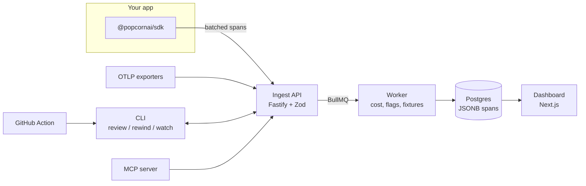

<p align="center">
  
</p>

<h1 align="center">Popcorn AI</h1>

<p align="center"><b>Grab the popcorn. Watch what your agent really did.</b></p>

<p align="center">Open-source tracing, replay and regression evals for TypeScript AI agents.</p>

<p align="center">
  <a href="https://www.npmjs.com/package/@popcornai/sdk"></a>
  <a href="https://www.npmjs.com/package/@popcornai/sdk"></a>
  <a href="https://github.com/alokmishra70/popcorn-ai/blob/main/LICENSE"></a>
  
  <a href="https://github.com/alokmishra70/popcorn-ai"></a>
</p>

<p align="center"><a href="https://github.com/alokmishra70/popcorn-ai/blob/main/docs/quickstart.md">Quickstart</a> · <a href="https://github.com/alokmishra70/popcorn-ai/tree/main/docs">Docs</a> · <a href="https://github.com/alokmishra70/popcorn-ai/tree/main/examples/support-agent">Example agent</a> · <a href="https://github.com/alokmishra70/popcorn-ai">GitHub</a></p>

<p align="center">
  
</p>

Popcorn is an open-source tracing, replay and regression-eval toolkit for tool-calling AI agents written in TypeScript. Wrap your LLM client and tools once; every run becomes a trace you can inspect, rewind against recorded tool outputs, and turn into a test case that runs on every pull request.

```ts
import { popcorn } from '@popcornai/sdk';

const anthropic = popcorn.wrapAnthropic(new Anthropic());
const lookupOrder = popcorn.tool('lookup_order', fetchOrder);

export const triage = popcorn.agent('support-triage', async (ticket: Ticket) => {
  // your agent loop, unchanged
});
```

## What you get

|                    |                                                                                                                                                                                  |
| ------------------ | -------------------------------------------------------------------------------------------------------------------------------------------------------------------------------- |
| **Record**         | Every model call, tool call, retry and error as a span tree, with tokens, cost and latency. Anthropic and OpenAI clients, streaming included. Under 0.3 ms of overhead per span. |
| **Scene by Scene** | A waterfall timeline of each run, the message thread as a conversation, full input and output of every span.                                                                     |
| **Bloopers**       | Runs flagged automatically: errors, loops (same tool, same arguments, 3+ times), cost spikes, step limits.                                                                       |
| **Rewind**         | Re-run a recorded run with tools stubbed to their recorded outputs and a new prompt or model, then diff it step by step against the original. No real API is touched.            |
| **Reviews**        | Save runs as test cases, check them with deterministic checks and LLM-as-judge, and get a pass/fail and cost diff against `main` locally and as a PR comment.                    |
| **Box Office**     | Runs, error rate, p50/p95 latency and spend per day, per model and per tool.                                                                                                     |
| **Watch**          | A live tail of incoming runs in the dashboard or the terminal.                                                                                                                   |

Plus OpenTelemetry ingest for agents in other languages, PII redaction before export, API keys per project, data retention, and an MCP server so Claude can debug your runs.

## How it fits together



Only the SDK runs inside your application. If Popcorn is down, spans wait in a bounded buffer and your agent keeps working.

## Quickstart

```bash
docker compose up        # API :4100, dashboard :3000, Postgres, Redis, a seeded project
npm install @popcornai/sdk
```

Then follow the [quickstart](docs/quickstart.md). The [dogfood agent](examples/support-agent) is a working example: a support-ticket triage agent on Claude with a 40-case eval suite, runnable offline with no API key.

## Numbers

Measured in this repo on an Apple Silicon laptop with local Postgres 14, Node 22. Reproduce with the commands shown.

| Metric                                       | Result                                                                                              | Target                | How                                                                                 |
| -------------------------------------------- | --------------------------------------------------------------------------------------------------- | --------------------- | ----------------------------------------------------------------------------------- |
| SDK overhead per span, p95                   | 0.25 ms                                                                                             | < 5 ms                | `pnpm bench:sdk`                                                                    |
| Ingest throughput, one API process, no queue | ~11,000 spans/s, p95 46 ms per 100-span batch                                                       | 500 spans/s on 2 vCPU | `pnpm --filter @popcornai/api bench`; `k6 run bench/ingest.k6.js` on your target VM |
| Tests                                        | 109: 100 unit and integration (against real Postgres), 9 Playwright e2e; SDK statement coverage 80% | 80% on SDK and API    | `pnpm test`, `pnpm test:e2e`                                                        |

## Repository

| Path                     | Package           | What it is                                                                                     |
| ------------------------ | ----------------- | ---------------------------------------------------------------------------------------------- |
| `packages/core`          | `@popcornai/core` | Span schema, pricing, anomaly flags, run diffing, eval checks. Pure, shared by everything else |
| `packages/sdk`           | `@popcornai/sdk`  | The tracing SDK: context propagation, exporter, client wrappers, rewind                        |
| `packages/db`            | `@popcornai/db`   | Drizzle schema, migrations and queries                                                         |
| `packages/cli`           | `@popcornai/cli`  | `popcorn review`, `rewind`, `watch`, `dataset add`                                             |
| `packages/mcp`           | `@popcornai/mcp`  | MCP server: `search_runs`, `get_run`, `run_eval`                                               |
| `apps/api`               |                   | Fastify ingest and query API, BullMQ worker                                                    |
| `apps/dashboard`         |                   | Next.js dashboard                                                                              |
| `examples/support-agent` |                   | Dogfood agent and eval suite                                                                   |
| `.github/actions/review` |                   | GitHub Action that comments review results on PRs                                              |
| `docs`                   |                   | User docs, also served at `/docs` in the dashboard                                             |

## Development

Node 20+, pnpm (via corepack) and Postgres. Redis is optional.

```bash
corepack enable
pnpm install
cp .env.example .env                     # point DATABASE_URL at your Postgres
pnpm build
pnpm db:migrate && pnpm db:seed          # prints an API key for .env
pnpm dev                                 # API on :4100, dashboard on :3000
```

```bash
pnpm test                                # unit + integration (set TEST_DATABASE_URL for DB tests)
pnpm lint && pnpm typecheck
scripts/demo-data.sh && pnpm test:e2e    # seed demo data, then Playwright
```

See [CONTRIBUTING.md](CONTRIBUTING.md) for conventions.

## Why another one?

Langfuse, LangSmith, Helicone and Braintrust cover tracing and evals well. Popcorn is deliberately small and self-hostable, and built around two things they treat as secondary: replaying a failed run against recorded tool outputs, and a regression check on every pull request. If you need a hosted platform with teams and prompt management, use one of those.

## License

[MIT](LICENSE)
