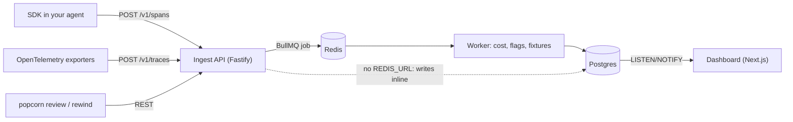

# Self-hosting

Popcorn is four processes and two stores:



Only the SDK runs inside your application, so a Popcorn outage never breaks your agent.

## Docker Compose

```bash
POPCORN_API_KEY=pk_$(openssl rand -hex 16) docker compose up -d
```

| Variable                                               | Service     | Default                  | Description                                                  |
| ------------------------------------------------------ | ----------- | ------------------------ | ------------------------------------------------------------ |
| `POPCORN_API_KEY`                                      | migrate     | `pk_local_change_me_...` | Key created for the seeded project                           |
| `RETENTION_DAYS`                                       | api, worker | `0`                      | Delete runs older than N days, nightly. `0` keeps everything |
| `POPCORN_READ_ONLY`                                    | dashboard   | `false`                  | Public demo mode: no writes, no key management               |
| `POPCORN_DASHBOARD_USER`, `POPCORN_DASHBOARD_PASSWORD` | dashboard   |                          | Enables HTTP basic auth                                      |

The dashboard has no user accounts. Put it behind basic auth (above), your SSO proxy, or a private network.

## Without Docker

Postgres 14+ and Node 20+. Redis is optional: without `REDIS_URL` the API writes spans during the request instead of through the worker.

```bash
pnpm install && pnpm build
cp .env.example .env            # set DATABASE_URL
pnpm db:migrate
pnpm db:seed                    # prints an API key
pnpm --filter @popcornai/api start
pnpm --filter @popcornai/dashboard start
```

## API configuration

| Variable             | Default           | Description                                               |
| -------------------- | ----------------- | --------------------------------------------------------- |
| `DATABASE_URL`       | required          | Postgres connection string                                |
| `PORT`, `HOST`       | `4100`, `0.0.0.0` | Listen address                                            |
| `REDIS_URL`          |                   | Enables the queue; run `node apps/api/dist/worker.js` too |
| `WORKER_CONCURRENCY` | `4`               | Ingest jobs processed in parallel per worker              |
| `CORS_ORIGINS`       |                   | Comma-separated origins allowed from browsers             |
| `BODY_LIMIT_MB`      | `16`              | Max request size                                          |
| `LOG_LEVEL`          | `info`            | Pino log level                                            |

## Endpoints

All `/v1` routes need `Authorization: Bearer <project key>`.

| Method | Path                         | Purpose                                                                                                |
| ------ | ---------------------------- | ------------------------------------------------------------------------------------------------------ |
| POST   | `/v1/spans`                  | SDK ingest, 202 on accept                                                                              |
| POST   | `/v1/traces`                 | OTLP/HTTP JSON ingest                                                                                  |
| GET    | `/v1/runs`                   | List runs: `status`, `flags`, `model`, `tool`, `name`, `from`, `to`, `minCost`, `q`, `cursor`, `limit` |
| GET    | `/v1/runs/:id`               | Run with all spans                                                                                     |
| GET    | `/v1/runs/:id/replay`        | Input, spans and fixtures for `rewind`                                                                 |
| GET    | `/v1/runs/:id/diff/:otherId` | Step diff of two runs                                                                                  |
| GET    | `/v1/datasets`               | Datasets with case counts                                                                              |
| GET    | `/v1/datasets/:name`         | Dataset and cases                                                                                      |
| POST   | `/v1/datasets/:name/cases`   | Add a case from `sourceRunId` or `input`                                                               |
| POST   | `/v1/eval-runs`              | Store a review                                                                                         |
| GET    | `/v1/eval-runs/:id`          | Review with results                                                                                    |
| GET    | `/v1/eval-runs/:id/compare`  | Compare with `baseline=<id>` or the latest on `branch`                                                 |
| GET    | `/v1/stream`                 | Server-sent events of run updates                                                                      |
| GET    | `/healthz`, `/readyz`        | Liveness and database readiness                                                                        |

## Data and privacy

Span payloads are stored in Postgres as JSONB. API keys are stored as SHA-256 hashes. Values under auth-like keys are stripped by the SDK before export; add `redactors.email` and `redactors.phone`, or your own redactor, for anything else that must not leave your process.

## Capacity

Measured on the reference setup (see the README for numbers and how to reproduce them with `bench/ingest.k6.js`). Ingest is idempotent on span id, so SDK retries after a timeout never double count.
